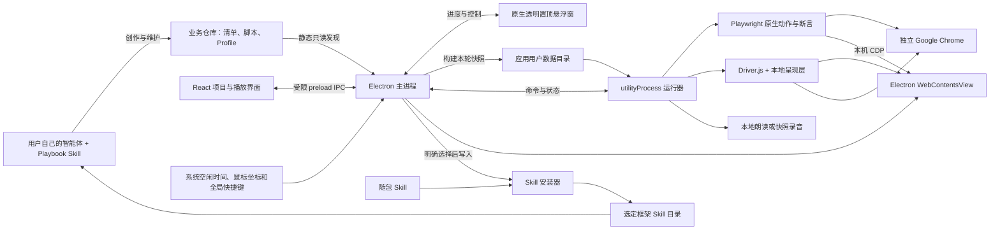
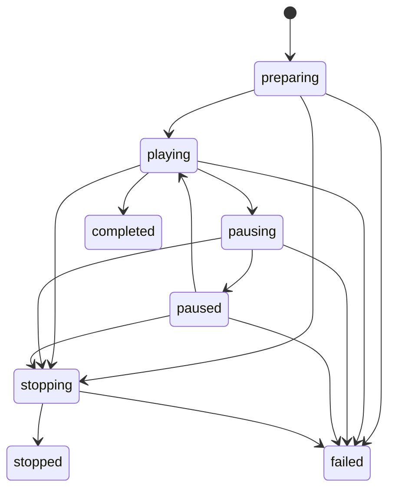

# Playbook 技术架构

本文说明客户端、运行器和业务脚本之间的接口与数据边界。清单与脚本使用 `schemaVersion: 1`；操作方法见[使用指南](usage.md)，环境检查见[检查与排错](verification.md)。

## 进程与职责



| 模块 | 当前职责 | 写入边界 |
|---|---|---|
| 用户智能体 + Skill | 需求引导、脚本创建/维护、讲解与效果调整、Book/Section 编排、测试转换和修复 | 用户的创作环境维护业务资产 |
| `ui/` | 文件夹/Book 两层树、Book 列表、Section Tab、脚本详情、搜索、环境选择、播放控制、记录与安装页 | 确认删除 Book 时调用受限清单维护入口；无通用文件编辑 API |
| `desktop/preload.cjs` | 有限的 `window.playbook` 方法与完整状态订阅 | 不暴露任意文件系统、`ipcRenderer` 或代码执行接口 |
| `desktop/main.mjs` | 项目登记、重新发现、选择校验、构建调度、运行器生命周期、原生悬浮窗、活动检测、系统快捷键、记录与剪贴板 | 应用设置、备份、记录、缓存与显式 Skill 安装 |
| `desktop/playback-control.mjs` | 原生悬浮窗生命周期、位置、活动显隐与受限控制状态 | 不写业务资产或记录按键内容 |
| `desktop/library.mjs` | 路径校验、静态 TS 元数据、清单引用、环境选择和 esbuild 快照 | 构建产物写应用缓存 |
| `desktop/runner.mjs` | 快照加载、Chrome、Profile、步骤调度、暂停/停止和事件 | 业务动作由可信脚本执行；管理自身临时资源 |
| `desktop/presentation/` | 开场/章节、Driver.js 提示、蒙层、柔边光圈、区域遮盖和演示光标 | 本轮页面注入；不注入进度条或播放控制 |
| `desktop/skill-installer.mjs` | 预览、版本/摘要识别、备份、替换核验与失败恢复 | 选定的本 Skill 目录及应用备份 |
| `src/index.ts` | 类型契约、`definePlaybook`、`defineProfile` 和测试复用参考执行器 | 业务准备与资源仍由调用者负责 |

主窗口关闭 Node 集成，启用 `contextIsolation` 和 `sandbox`。业务页面可在外部 Chrome 或内置 WebContentsView，普通业务页面不加载客户端 preload。仅可核验的内置教程会取得三个受限 Skill 方法；写入另需匹配的手动步骤和用户点击。运行器是独立 Node 进程，但脚本与 Profile 仍是可信本机代码；独立进程不是恶意代码权限沙箱。

## 创作、发现与反馈

业务文件是创作端和播放端的接口。智能体维护清单、TypeScript 脚本与 Profile；客户端没有编辑器、编排面板、聊天或模型账户，也不直接调用智能体。

用户界面统一使用“项目”。一个项目对应含 `.playbook.json` 的已登记目录，API 中的 workspace 指同一对象，不存在另一份独立资料库。左侧导航仅显示项目文件夹 → Book 两层；进入时展示 Book 列表，选中后侧边栏变窄，右侧完整展示 Book。Section 使用带键盘切换的 Tab，脚本在所属 Tab 下平铺，步骤在同一内容区查看。清单内仍按 Book → Section → 脚本组织，按名称、摘要、清单标签和角色搜索。详情展示内容顺序、说明、步骤、数据类别、数据影响与重播要求；可选择已有 Profile、显示源文件位置或复制修改上下文。

反馈通过剪贴板交接，包含工作区、脚本/流程引用、运行状态、构建摘要和错误；用户自行粘贴给智能体。应用不自动发送任务消息或上传业务内容。

内置教程和入门样例也允许移出项目或删除 Book。删除状态按稳定的 tutorial/starter 标识和 Book ID 保存到本机设置，发现时过滤；不改写随包清单。刷新、重启和安装目录变化不会重新加入；明确添加项目只恢复项目登记，不恢复已删除 Book。设置 schemaVersion 1 保持兼容，可选 hiddenBuiltins/hiddenBuiltinBooks 字段，写入前备份并核验，包括初始默认设置。

## 工作区发现契约

当前项目根目录须有 `.playbook.json`：

```json
{
  "schemaVersion": 1,
  "title": "业务演示项目",
  "profiles": [
    { "id": "training", "title": "培训环境", "file": "demos/profiles/training.profile.ts", "dataMode": "real", "parameters": {} }
  ],
  "scripts": [
    { "file": "demos/flows/course.playbook.ts", "profile": "training", "tags": ["教师", "课程"] }
  ],
  "books": [
    {
      "id": "course-training", "title": "课程使用培训", "summary": "查看课程与预览任务", "profile": "training",
      "sections": [
        { "id": "course-basics", "title": "课程入门", "summary": "从课程查找到任务预览", "scripts": ["course.preview"] }
      ]
    }
  ]
}
```

Section 引用的脚本 ID 来自 TypeScript 默认导出。Book ID 在项目内唯一，Section ID 在所属 Book 内唯一，两者只使用 `[A-Za-z0-9._-]+`；Section 组合键为 `bookId/sectionId`。这是格式说明，不是产品提供的真实业务环境；可运行合成样例见 `examples/starter/`。

Book 和 Section 是引用与顺序容器，没有独立业务 callbacks。Book“播放全部”先按 sections 数组展开章节，再按各章 scripts 数组展开脚本；Section“播放全部”仅按自身 scripts 数组展开。单脚本仍可播放。旧 `demos: [{ id, title, summary?, scripts, profile? }]` 读取时归一为 Book 和单个 Section，兼容过程不回写原清单。

发现过程会规范化项目根目录，要求资产为根目录内的可读文件，拒绝绝对或解析后越界的资产引用，并校验版本、重复标识及脚本/环境/Book/Section 引用。

元数据由 TypeScript AST 静态读取，不 import 业务模块。当前支持默认导出的 literal 对象，或 `definePlaybook({ ... })` 的 literal 参数，允许 `as`/`satisfies` 包装；不解析变量引用、spread 和任意计算出的元数据。动作与断言仍是原生函数。

无效脚本保留为不可播放条目；项目与容器引用错误明确显示，不自动修复源码。当前没有“保留上一份完整有效索引”的缓存策略。

客户端约每 1.4 秒重新发现一次。清单、脚本、Profile、有界遍历的本地 import 内容与声明的录音参与项目 token；这不是全文件系统监听，也未覆盖任意动态读取资产或全部依赖锁变化。标签来自 `scripts[].tags`。Profile 参数不传 Renderer；私密值应由业务侧私有文件或既有凭据机制提供。

## 构建快照与检查入口

点击播放后，主进程重新发现、校验条目和环境数据类别，再由 esbuild 将脚本与 Profile 构建为本轮 `flow.mjs`。`@playbook/core` 指向产品内置核心，Playwright 来自产品依赖，其余依赖按工作区解析；业务依赖由项目提供。

产物写应用用户数据目录的本轮缓存。`snapshotHash` 来自构建代码、参数与声明的录音快照；构建后重新检查项目 token，期间变化则拒绝启动。本轮执行已构建快照，并保存步骤信息用于运行展示；来源变化只影响下一轮。录音限定为工作区内的相对路径与支持格式，构建时校验并复制为本轮资源，不在播放途中重新读取源录音。

快照固定构建代码，不隔离业务服务、网络、运行时读取文件等外部状态，也未对整个项目依赖目录做可复现归档。

`--check-workspace <directory>` 走同一发现、选择与构建路径，输出 JSON 和退出码，不启动业务浏览器，不执行 Profile/步骤。结果明确含 `typecheck: "not-run"`、`browser: "not-run"`，不能当作类型或业务验收。

## 演示与测试入口

桌面入口：选择脚本、Section 或 Book 与已有 Profile → 按容器顺序展开脚本 → 构建快照 → `utilityProcess` 加载 → 所选浏览器 → 每脚本准备上下文 → 引导、动作、断言 → 释放资源 → 记录结果。

测试入口继续使用原项目 Playwright Test 的 fixture、配置、报告和 teardown，通过 `runPlaybook`/`test.step` 复用同一流程，或由 Skill 导出独立 TC。

桌面运行器使用 Playwright Library，不继承任意 TC 的 runner 生命周期。任意 `.spec.ts` 不能直接作为演示模块 import；转换须映射 fixture、认证、准备、事件等待、断言和清理。未映射依赖须列为缺口，不承诺任意 TC 自动转换。

## Profile 与数据边界

Profile 默认导出 `defineProfile({ ... })`，提供 `schemaVersion`、`id`、`title`、`dataMode`、`roles` 和 `prepare({ page, workspaceDir, parameters })`。成功返回 `{ context, release? }`，`context.page` 必须是运行器提供的页面。Profile 负责业务地址、登录、角色、前置数据与自身资源，旧 Profile 仍自行处理部分准备失败；新 Profile 可在资源创建前 await registerCleanup，让应用提前保存责任。返回 release 先登记，再校验 context.page。

运行器校验脚本 schema、数据类别和所需角色。`reset-required` 要求 Profile 声明 `resetBeforeRun: true`；实际重置仍由 Profile 实现并验证，声明本身不会重置数据。`single-run` 在开始执行前持久化执行占用，避免直接重播已可能产生作用的流程；后续须先核对数据并完善恢复策略。

Book/Section 整次播放使用用户所选同一 Profile，每个脚本的数据模式与角色要求都必须兼容。它们按清单脚本 ID 串行运行，每个脚本重新创建页面并 prepare/release，不隐式共享前一个脚本的内存上下文。JSON 保存引用和顺序，动作与断言保留在 TypeScript。

## 播放控制与呈现

Renderer 调用 `play({ workspaceId, entryId, kind, profileId })` 与 `control('pause' | 'resume' | 'stop')`。主进程按当前 runId 接收事件；`getState` 与 `onState` 提供完整状态。运行历史持久保存，界面只展示最近 100 条。

`kind` 区分脚本、Section 和 Book；Section 的 entryId 使用组合键。主界面将当前选项与 Profile 同步给主进程，供空闲时全局播放键使用；播放仍经过同一选择、兼容性和重播策略校验。全局控制不绕过主进程运行状态。主进程按 runId 保存最新的暂停/停止意图，准备期间也保留意图；快速连续切换按用户最后一次请求处理，避免依赖滞后的运行器阶段。



步骤顺序：校验目标唯一且可见 → 滚动定位 → 说明/光标引导与可选语音 → 讲解和最短停留均完成 → 点击反馈并清理临时提示 → 原生 `run` → 原生 `verify` → 更新结果。流程打码持续按实际页面定位，不随单步提示清理。无目标步骤使用居中说明；新文档重新注入引导。Driver.js 与呈现资源从应用本地读取，不依赖 CDN。

当前支持脚本级光圈半径、柔边、蒙层透明度、光标移动时间、默认停留和开场时间，以及步骤级章节、方向、停留与操作后间隔；核心契约校验参数范围。`presentation.spotlightFeather` 为 0–100 px、默认 24，通过渐变过渡使光圈边缘柔和，0 保留硬边。

流程 `redactions` 为 `{ selector, mode?, label?, blurPx?, padding? }[]`，不支持放进 step。selector 使用 CSS 语法，随滚动、重渲染、弹窗和同一主页面导航重新定位；cover 默认不透明覆盖，blur 仅视觉模糊。遮盖层不拦截鼠标，原动作和断言仍操作原控件，不改 DOM 业务值。原值仍在 DOM/API，且 blur 不保证不可辨识，因此这不是安全脱敏。跨 frame、新页面仍需另行适配，讲稿和录音不得重新泄露实际敏感值。

流程 `narration` 包含 enabled、voice、rate 和 opening，步骤 narration 可为 false 或 `{ text?, audio? }`，文字和录音互斥。默认关闭；enabled 为 true 时开场读 title 与 summary，每步读 explain；单步对象可独立启用，false 静音。opening 可以关闭或覆盖开场讲解。语音与页面提示/光标配合播放，当前音频与最短 hold 均完成后才操作，不靠猜音频长度设置等待。

macOS 文字朗读使用本机 `say` 生成 WAV，默认 Tingting、185 words/min，rate 范围 80–400；不请求云服务或模型账户。所选声线须在系统可用，生成或播放失败向上传播并停止。系统文字朗读仅支持 macOS，其他平台需使用本地录音。audio 使用工作区相对路径，支持 wav/mp3/m4a/ogg、单文件不超过 20 MB，拒绝网络 URL、绝对或越界引用并随本轮快照冻结。语音控制与运行器暂停/继续/停止同步，停止释放当前播放资源；实际听感与系统输出设备仍需实测。

`runPlaybook` 的测试入口不处理柔边、打码或语音，也不增加相应等待。Skill 独立导出 TC 时移除这些元数据和资源调用，保留动作、断言与测试生命周期，不将遮盖转成 DOM 修改或测试步骤。

暂停在说明计时、光标移动和步骤边界检查。进行中的业务动作先进入“正在暂停”，待边界后暂停，不撤回已发出的请求。继续时，运行器先用该页面的 CDP 会话查询并恢复最小化的 Chrome 窗口，再调用 `page.bringToFront()`，之后才释放暂停。恢复期间收到较新的暂停或停止会覆盖先前继续请求。停止取消独立的执行 signal、旁白和后续调度，不提前关闭 Chrome 破坏 Profile 留证。不配合取消的代码超过停止宽限后记为执行和清理未知，再终止运行器；不会自动回滚已完成写入。终态可从客户端重播，仍经过数据策略校验。

成功、失败和停止均按登记逆序执行清理，同函数 identity 去重，单轮不自动重试。每次 prepare 对应的整组清理默认 60 秒预算，与默认 30 秒执行停止宽限分开，不继承已取消的 signal。分别保存业务与清理错误，清理后复查停止意图才确认终态；之后回收失败和停止的浏览器。当前引导范围为单个主页面，跨窗口、frame、上传下载及系统对话框需单独适配验收。

## 原生全局悬浮控制

独立播放的进度与控制由客户端的透明置顶 `BrowserWindow` 展示；内置播放使用主窗口顶部控制栏，隐藏悬浮条以避免遮挡。两者都独立于业务页面 DOM。浏览器注入层只负责开场、箭头、蒙层、光圈等引导，不再包含下方进度条或播放控制按钮。原生悬浮窗接收主进程同一份运行状态，通过受限 IPC 发送控制命令，不在页面重复调度动作。

窗口启用 `movable`，文字与空白区域通过 CSS `-webkit-app-region: drag` 使用系统拖动，按钮显式排除拖动。最小化在受限 IPC 下切为 300×80 小条，展开为 800×104；保留会话内位置和收起状态。仅首次显示、收起/展开、完成拖动或显示器变更时调整位置并限制在可见工作区内，不随输入轮询重新居中。

主进程轮询 `powerMonitor` 的系统空闲时间与 `screen` 的鼠标坐标，检测鼠标/键盘活动；约 3 秒无活动隐藏，活动后显现。它不读取按键内容，不安装额外全局键盘 hook 依赖。显隐是客户端行为，不是脚本 presentation 配置；系统对空闲时间、置顶层和桌面空间的行为须按目标系统实测。

`globalShortcut` 注册默认 `CommandOrControl+Alt+P`（Mac 为 `⌘⌥P`）。运行中切换播放/暂停，空闲时播放主界面当前选择，终态允许重播；动作仍遵守暂停边界、单运行器与重播策略。注册失败在客户端明确提示，退出时注销快捷键；不承诺永不冲突，也不把跨平台支持视为已通过验收。

## 内置 Skill 安装

完整创作、维护、呈现调整与 TC 转换 Skill 来源为 `skills/playbook-wright/`，兼容入口来源为 `skills/playbook-playwright/`，随应用和 Skill 压缩包交付。下表为主目标，另在同一 skills 父目录安装 `playbook-playwright/` 轻量入口，链接主 Skill；不依赖虚构的 aliases 元数据或软链接。当前目标：

| 框架 | 个人目标 | 项目目标 |
|---|---|---|
| Codex | `~/.agents/skills/playbook-wright` | `<project>/.agents/skills/playbook-wright` |
| Claude Code | `~/.claude/skills/playbook-wright` | `<project>/.claude/skills/playbook-wright` |

用户先选框架/范围；项目范围通过系统文件夹选择器指定任意现有项目目录，不限已登记的演示目录，也不要求 .playbook.json。主进程只接受本次应用会话中通过选择器选过、仍可访问且未被重定向的目录；不自动猜测上级仓库。按框架追加上述固定子目录，预览完整目标、版本、文件数和状态，明确点击才写入。取消选择保留旧目标，更换目录重新预览；选择和预览不写 Skill、不登记演示项目。内置样例不能作项目目标；不支持改写框架子目录或自动批量安装。

| 状态 | 行为 |
|---|---|
| `new` | 明确点击安装 |
| `installed` | 同版本且摘要一致，禁止重复安装 |
| `update` | 点击“备份并更新 Skill”后备份与替换 |
| `modified` / `conflict` | 须勾选“先备份再替换已有内容” |
| `symlink` | 保留原链接，不安装 |

安装器快照并哈希校验来源与目标，拒绝软链接、越界和不支持的文件类型；目标变化则停止。已有内容在应用 `backups/skills/` 完整备份并核验，附恢复说明，再替换与核验；失败尝试恢复。客户端尚无一键恢复页面。两个入口预先检查，任一有修改或冲突都须明确替换后才开始写入；兼容入口为软链接则整组阻止。按主入口、兼容入口顺序分别执行原子替换和核验；第二个入口失败会报告部分完成并保留已完成主入口，可重新检查后重试，不把跨目录安装称为单次原子事务。界面展示全部目标和备份路径。

仅处理所选 Skill 子目录，不改全局规则、hooks、模型设置或凭据；额外文件按安装规则尽量保留，同名冲突原件留在备份。文件安装成功不表示智能体已加载，当前未探测加载状态。

## 本地数据与分发

用户数据目录保存 `settings.json`、`runs.json`、`cache/`、`backups/`。项目登记修改前复制核验设置备份，再原子写入。历史运行持久化；重启不会自动恢复未完成业务动作。`PLAYBOOK_USER_DATA` 可为开发/验收指定隔离目录。

记录含步骤、进度、环境、时间、摘要与错误。脚本 stdout/stderr 不转发；错误做敏感字段遮盖和长度限制，不能保证任意业务文本完全脱敏。截图/视觉检查目前由验收环境开关启用，尚无用户 trace、视频或脱敏导出流程。

`desktop:build` 构建核心、主进程、运行器、preload 与 Vite 界面；`package:mac` 生成 macOS arm64 应用、DMG 和 ZIP。运行环境与依赖随应用交付，无需外置 Node。外部模式使用本机 Chrome，内置模式使用 Electron 浏览器；两者均不连接日常 Chrome 会话。

## 支持范围

安装包面向 macOS Apple Silicon，未签名、未公证，不含应用内自动更新。内置浏览器以单个主页面为主；新窗口、复杂 frame、扩展或系统对话框流程需要选择合适容器并单独适配。排错方法见[检查与排错](verification.md)。

## PPTX 输出链路

Book/Section/脚本详情经受限 IPC 请求导出。主进程先打开系统保存窗口，取消不启动任务；确认后沿用 play 调度、重播保护和静态快照，启动同一运行器，额外提供本轮缓存 exportDir。业务源码和录音不写回。

运行器以 1440×810 视口执行实际 Chrome 流程。开场和步骤在对应语音开始前截图，目标步骤为截图临时摆放光圈再恢复实际光标；开场、章节和操作前提示保留当前呈现层；每次 run/verify 后隐藏引导层截取结果，独立打码层继续生效。讲解来源仍由 narrationSource 读取冻结录音或本地合成，Chrome OfflineAudioContext 解码并重采样为单声道 PCM WAV，无外部 ffmpeg/Node 服务要求。

`desktop/pptx.mjs` 使用 PptxGenJS 生成截图页和备注，使用 JSZip 添加标准 Open XML transition（advTm/advClick）和 audioFile/p14:media 嵌入关系、原生自动播放时间线，以及放映 useTimings。旁白在当前页播放一次并在放映时隐藏，采用独立媒体生命周期。读取完整 PCM WAV 计算音长；最终时间取基础时长、音长加 1 秒及最短阅读时间的最大值，并向上取整到整秒；章节/结果至少 2 秒，其余至少 3 秒。不记录人工暂停、运行准备、网络等待和导出处理耗时。时间规则见 Skill 导出指引。

所有业务校验和 Profile release 成功后才在缓存构建 deck.pptx。主进程核对停止意图，在用户选择的文件夹内暂存，再一次替换目标；停止、失败不提交半成品。保存提交点同步写入完成状态，避免停止命令把已保存文件误记为未保存。运行记录保存输出路径、页数、内嵌音频页数和总时长，按 runId 打开/定位，renderer 不提供任意写入路径。音频生成、解码、截图、构建或保存失败均可见，不静默跳过。

浏览器操作和呈现阶段仍支持暂停/继续；生成 PPTX 阶段只支持停止，暂停按钮禁用，全局暂停键忽略。缓存保留本轮快照、截图及音频供诊断，遵循现有本机用户数据边界。输出是可分享内容，应检查画面和备注/音频，不将视觉遮盖当作业务数据脱敏。

## 资源回执与重启恢复

`desktop/lifecycle.mjs` 管理每次 prepare 的清理 scope、可选精确恢复句柄、预算与脱敏。registerCleanup 等待主进程将 JSON 责任写入 runs.json 并确认，调用方须 await 后再创建资源。写入串行化，以临时文件、fsync、rename、目录 fsync 提交；不序列化函数或参数凭据。只有 final 回执可落成功终态，晚到结果不覆盖未知状态或吞掉错误。

停止采用首次请求的绝对截止时间，pending 登记不能续期；清理 running 有独立截止时间，主进程另留 2 秒检测无响应，清理结束后最多等待 10 秒最终回执。关窗、Quit、渲染进程异常统一协调停止、清理、保存后退出；预启动等待期间退出也阻止随后启动业务。单一数据目录使用实例锁，worker PID 在 spawn 后持久化。

重启将未结束记录标为未知并保留成功责任和原错。用户点击恢复后核对 lifecycleVersion、应用版本、规范工作区路径/标识/源码 token、Profile 文件、脚本顺序、run/scope/flow 身份和冻结 flow.mjs 的 SHA-256；运行器再核对 Profile.recovery.version。原 worker 仍存活、代码不匹配、旧 Profile 无声明时要求人工核对。恢复只调用 Profile 幂等 recover，不调用 prepare 或业务步骤，不扫描猜测资源，不改变 retain/purge 策略。

已确认成功的责任不会再次恢复；业务删除完成而回执未保存的强杀窗口仍可能重复调用同一 scopeId/cleanupId，业务须幂等。公开接口见 [SDK 类型](../src/index.ts)；完整生命周期指引见 [随包 Skill](../skills/playbook-wright/references/lifecycle.md)。

## 内置浏览器与手动交接

使用 Electron 的 WebContentsView 展示页面，Playwright 通过本机随机 CDP 端点连接，仍执行原有 Locator、run/verify 和 Profile，不自建另一套动作引擎。主进程只创建和识别本轮 owned target；现有客户端界面、播放条使用另一内存分区，不和演示登录会话共用存储。本轮共用演示上下文，逐脚本新建页面；浏览器弹出窗口当前被阻止，多窗口或多上下文流程使用外部模式。

讲解完成后，interaction.mode=manual 会移除引导遮挡并交还操作，不调用 run。真实输入重置计时，原生选择器/安装任务忙碌时冻结。手动继续或等待到期均保存交接回执，但不写成操作成功；之后仍执行 verify。公开交互接口以 [SDK 类型](../src/index.ts) 为准。

所有临时浏览器缓存使用精确路径、nonce、PID、appid 和归属标记登记；正常退出删除本轮目录，重启只核验已登记的死进程会话，不扫描其他临时目录、业务资源或证据。
