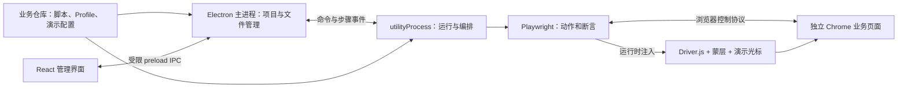
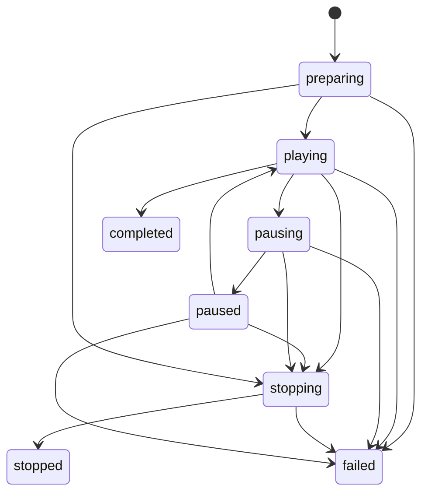

# Playbook 技术架构

状态：实现建议。当前仓库仅实现脚本契约与小型参考执行器；下述 Electron 播放器尚未实现。

## 进程与职责



这是对底层平台能力的组合设计。Electron 主进程提供 Node.js 环境；`utilityProcess` 可启动具备 Node.js 和消息端口的独立子进程，因此可以把运行器与管理窗口分开，并随应用交付运行环境。[Electron 进程模型](https://www.electronjs.org/docs/latest/tutorial/process-model)、[utilityProcess API](https://www.electronjs.org/docs/latest/api/utility-process)。

| 层 | 负责 | 约束 |
|---|---|---|
| Renderer | 项目、脚本、演示、控制台与记录页面 | 本地界面；不开 Node 集成，开启 contextIsolation 与 sandbox |
| Preload | 暴露有限的项目与播放命令，订阅事件 | 不直接暴露 ipcRenderer、文件系统或任意代码执行 |
| Main | 路径选择、项目登记、配置写入、进程与应用生命周期 | 校验消息来源、参数、路径和当前 runId |
| Runner | 加载受信任工作区、Profile、流程调度、运行状态与结果 | 独立运行，退出时释放自己创建的浏览器和临时会话 |
| Playwright | 浏览器、页面、Locator、原生动作和业务检查 | 使用原生 API，不重建点击与等待引擎 |
| 页面呈现层 | 章节、提示箭头、遮罩、光圈与播放按钮 | 注入可移除；不持有密码、不访问 Electron bridge |

Node.js 的职责是执行 Playwright、读取本地脚本、管理浏览器和运行记录。产品精简方式是把运行环境装进 Electron，而不是删除执行环境。无需单独部署 Node 服务；进程仍存在，但由桌面应用管理。

## 两种运行入口

**演示入口**：应用选择 Profile → 独立运行进程准备上下文 → 运行共享流程 → 每步叠加呈现 → 执行动作 → 检查断言 → 释放 Profile → 记录结果。

**测试入口**：原项目 Playwright Test 配置和 fixture → 准备上下文 → 调用同一流程，使用 `test.step` 包裹 → 原测试框架完成报告、重试与 teardown。

演示运行器采用 Playwright Library 控制浏览器；测试继续使用 Playwright Test 管理测试生命周期。这两者共享浏览器 API，但 Library 不自动继承 Test 的 fixture、配置、重试和清理机制。[Playwright 官方说明](https://playwright.dev/docs/library)。

因此不能把任意 `.spec.ts` 当普通模块导入演示运行器。Skill 提取可复用流程，原测试 fixture 留在 TC 入口；演示 Profile 显式提供相应准备与释放，未映射的依赖标记为未就绪。

## 脚本、Profile、演示配置

业务侧建议布局，不要求修改业务源码目录：

```text
business-project/
  demos/
    flows/*.playbook.ts       # 动作、断言、讲解；业务真源
    profiles/*.ts             # 可审查的 prepare/release 逻辑
    profiles/*.local.json     # 私密地址、账号绑定、会话引用；忽略 Git
    presentations/*.demo.json # 引用流程的有序编排
    conversions/*.md          # 转换对应与验证结果
  tests/                     # 原测试与引用共享流程的 TC
```

应用工作区配置记录项目根、入口清单与依赖来源。清单是静态元数据；发现脚本时不在主进程直接 import 任意业务代码。需要解析 TypeScript 或构建模块时，在专用进程完成，并在运行快照中记录文件哈希与依赖锁文件哈希。

Profile 的目标接口为 `prepare(options) -> context + release`，由业务上下文类型约束。prepare 负责 baseURL、角色会话、业务前置数据；release 负责其拥有的临时资源。部分 prepare 失败也需释放已创建资源。运行器在成功、失败、停止时均进入 finally 释放；不能借 release 清空不属于本次的数据。

项目自定义依赖由项目锁定。首版不自动安装任意业务包：产品内置核心依赖，发现额外依赖缺失时列出项目级准备要求。纯浏览器脚本可不要求用户安装 Node；依赖特殊数据库驱动、原生模块或测试工具的 Profile 要先验证打包及兼容性，不能沿用开发机 node_modules 就宣称免安装。

演示配置只保存脚本 ID/路径、顺序、章节、Profile 引用和节奏。类型化脚本是可执行代码，不是可用 JSON 序列化的闭包。JSON 配置只做引用与呈现覆盖，不重新描述一整套 Playwright 指令。

## 播放协议与状态

控制命令建议为 `start(demoId, profileId)`、`pause(runId)`、`resume(runId)`、`stop(runId)`；事件包含 `runId`、递增序号、脚本版本、步骤 ID、阶段、时间和脱敏消息。Renderer 不上传可执行字符串。



每步执行：重新解析目标 → 校验可见与唯一性 → 滚动定位 → 显示讲解 → 阅读停留 → 光标移动 → 隐藏会遮挡交互的呈现层 → 原生 `run` → 原生 `verify` → 记录结果。

交互式运行器需要在这些边界检查暂停/停止，呈现计时可中断。当前参考执行器只定义顺序，不实现暂停、取消、超时管理或资源生命周期；这些由后续 Runner 实现，不能把参考代码当完整播放器。

`run` 内已经发起的请求不可可靠回滚。异常后不自动重放整步；特别是写入步骤，只有显式恢复策略完成且重新检查状态后才能重播。整个演示首版按串行脚本执行，每个脚本重新准备自己的上下文；不隐式把上一个脚本中的内存对象传给下一个。

## 注入与呈现细节

- Driver.js 与样式随应用打包，本地注入，不依赖 CDN。开场和播放器工具条由自定义层提供。
- 页面导航会销毁注入内容；运行器需在新的目标文档就绪后重新安装层，并将控制绑定到当前运行。SPA 更新时重新取 Locator，不长期保存易失效的 DOM 节点。
- 蒙层、光圈和视觉光标共享同一坐标来源；实际原生动作仍使用 Locator，动作前重新检查位置，处理阅读期间布局变化。
- 原生 dialog 的 top layer、popover、滚动、缩放、窗口尺寸变化需专项验证。艺工现有样例已经发现并处理过 dialog 层级与 Driver.js 指针拦截问题，产品层应复用这些经验，并用通用合成页面复现。
- 首版支持单个主页面。新窗口、frame 的目标需要显式扩展上下文及呈现通道，不通过 CSS 选择器跨越浏览器隔离边界。
- 输入节奏可以在演示中使用原生渐进输入，但不可无差别把 `fill` 改成逐字输入：业务对 input/change 的响应可能不同，转换须验证语义。
- 恢复页面原样时移除本轮注入元素、监听器与样式；业务页面不永久安装 SDK。

## 运行隔离、凭据与记录

Renderer 使用受限桌面桥接；客户页面仅存在于独立 Chrome，不加载 Electron preload。Profile 和业务脚本仍然是受信任本机代码，独立进程主要解决故障隔离，并不限制恶意脚本对本机的读写能力。

非敏感模板可入 Git。密码通过系统凭据存储或既有私有凭据引用取得；cookies / storageState 属于敏感会话文件，在本机保存、限制权限并排除导出。导出的演示包默认不含这些值。对本机配置修改遵守用户环境的备份约定。

运行记录默认只含流程版本、数据类别、步骤状态、耗时与脱敏错误。截图、trace 和视频按需开启，登录过程不默认采集；导出前显示具体内容。完整 playwright trace 可能包含页面数据，不能把“脱敏日志”解释成 trace 自动脱敏。

## 打包与实施顺序

1. 先验证 Electron utilityProcess 加载固定版本 Playwright、启动本机 Chrome、退出回收，以及打包后的 Driver.js 资源路径。
2. 运行器与浏览器依赖资源放入可读取的应用资源区，验证 asar 路径、子进程入口和依赖解析；构建缓存与输出放在用户数据目录，不写应用安装目录。
3. 打包 TypeScript 脚本前解析业务工作区的 tsconfig 与依赖，保留源码映射；不把测试 runner-only API 当普通运行期依赖。清单、脚本、依赖变化使旧预检失效。
4. 完成 macOS 应用签名、公证、Intel/Apple Silicon 验证与 Chrome 缺失指引。首版先用系统 Chrome，后续若捆绑 Chromium，应单独评估体积、更新和离线分发。
5. 然后接入管理界面、演示编排与历史记录，再以艺工脚本做实际集成验收。

产品不依赖浏览器扩展，不要求开启用户日常 Chrome 的远程调试端口。后续“连接已有浏览器会话”属于独立能力，首版不包含。

## 本仓库当前代码范围

`src/index.ts` 是 v0.1 类型契约与参考执行器；`examples/catalog` 是无账号的模拟目录页与正反转换；`tests` 检查顺序、断言失败传播和 ID 唯一性。Electron、Profile 加载器、脚本打包器、引导层和实际管理界面均待后续实施。
